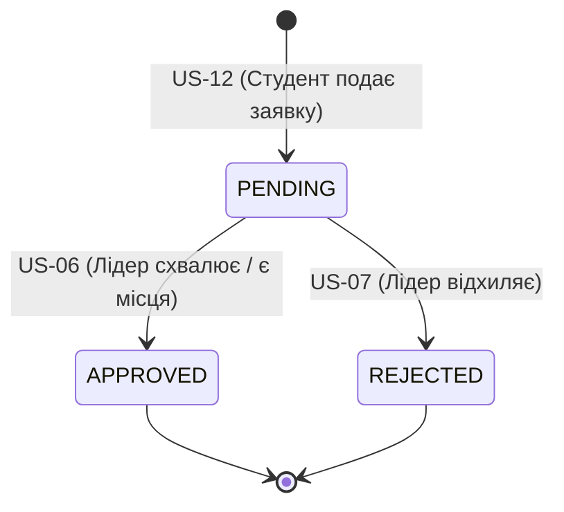

# Тема 5. Від вимог до технічного рішення

Коли після детального опису користувацьких історій розробник прагне якнайшвидше перейти до коду, виникає спокуса скопіювати вимогу в чат і попросити: *«Напиши мені бекенд і фронтенд для цієї задачі»*. У відповідь мовна модель миттєво згенерує сотні рядків коду, проте цей код використовуватиме випадкові бібліотеки, не під'єднається до спільної бази даних і створить хаос у структурі проєкту. Найпоширеніша помилка під час роботи з генеративним ШІ — вважати, що автоматизація звільняє інженера від проєктування архітектури.

В інженерній практиці діє суворе правило: **архітектура дорога, а код — дешевий**. Переписати окрему невдало згенеровану функцію можна за кілька хвилин, але зміна несумісних форматів даних, неналагоджених схем авторизації чи хаотичної структури бази даних коштує тижнів згаяного часу. Перехід від вимог до технічного рішення — це етап, на якому розробник визначає правила гри для штучного інтелекту: фіксує технологічні обмеження, структуру репозиторію, моделі даних та API-контракти. Лише у таких чітких інженерних рамках мовна модель перетворюється з джерела технічного боргу на потужного партнера з розробки.

**Після завершення цієї теми ви зможете:**

*   **Виявляти** приховані прогалини, бізнес-інваріанти та невизначеності у вимогах за допомогою системного аналізу (Requirements Digest).
*   **Формулювати** та документувати архітектурні рішення (ADR) з урахуванням реальних ресурсних обмежень команди.
*   **Проєктувати** технічні контракти системи: C4-діаграми контексту, діаграми станів (Mermaid State Diagrams), специфікації REST API та схеми баз даних.
*   **Створювати** матрицю простежуваності (Traceability Matrix) для наскрізного зіставлення вимог із компонентами коду та тестовими сценаріями.
*   **Налаштовувати** контекстну обв'язку репозиторію (AI-Harness) для керування консольними агентами штучного інтелекту.
*   **Ініціалізувати** наскрізний працездатний каркас застосунку (Walking Skeleton) без передчасного написання складної бізнес-логіки.

---

### Чому не можна одразу писати код: ціна архітектури

Пригадайте концепцію Spec-Driven Development, яку ми розглядали раніше: генеративний ШІ потребує суворих меж, інакше він схильний генерувати надлишковий та неструктурований код («нейрослоп»). Якщо інженер не визначить архітектурний каркас заздалегідь, модель обиратиме технології навмання під кожен окремий запит.

У великих продуктових компаніях — наприклад, в екосистемах із десятками мільйонів користувачів — інженерні процеси спираються на багаторівневу оркестрацію інструментів. Архітектура в такому середовищі виступає фільтром, який відсікає небезпечні чи надлишкові пропозиції ШІ ще до моменту написання коду.

```
[Вимоги: User Stories + Gherkin]
       ↓
1. Аналіз вимог і пошук прогалин (Requirements Digest)
       ↓
2. Архітектурні рішення під обмеження (ADR)
       ↓
3. Ескіз системи та технічні контракти (C4, API, DB)
       ↓
4. Налаштування контексту ШІ в репозиторії (AI-Harness)
       ↓
5. Каркас проєкту (Walking Skeleton)
       ↓
[Готовий фундамент для написання коду в IDE]
```

Перш ніж створювати креслення системи, необхідно змінити сам підхід до взаємодії з моделлю: відмовитися від ручного копіювання тексту у вебчати на користь професійних консольних інструментів.

### Зміна робочого інструменту: перехід до термінальних агентів

Традиційна робота через браузер виглядає неефективною: ви копіюєте вимоги у вікно чату, чекаєте на відповідь, вручну переносите код у файли проєкту та намагаєтеся самостійно відстежити помилки компіляції. Цей процес обриває зв'язок між файлами, швидко вичерпує оперативну пам'ять сесії та забирає багато часу.

Сучасна розробка базується на використанні **консольних агентів (CLI-інструментів, таких як Claude Code)**, які запускаються безпосередньо в терміналі всередині папки вашого репозиторію:

```
[Звичайний вебчат]       Ви ➔ копіюєте текст ➔ Браузер ➔ копіюєте назад ➔ Файл
[Термінальний агент]    Ви ➔ команда в терміналі ➔ Агент напряму читає та створює файли в репозиторії
```

Термінальний агент надає розробнику принципово нові можливості:
1.  **Прямий доступ до файлової структури:** ШІ самостійно зчитує вимоги з папки `docs/`, створює нові документи, модифікує схеми даних та розкладає артефакти без втручання людини.
2.  **Виконання команд середовища:** агент може самостійно запускати компіляцію, перевірку типів (`typecheck`), лінтери та автотести, миттєво виправляючи власні помилки в разі падіння збірки.
3.  **Контроль версій у Git:** інструмент бачить поточну гілку, вміє аналізувати `git diff` і фіксувати зміни логічними комітами.

#### Режими роботи агента: контроль над діями ШІ
Для запобігання неконтрольованим змінам у кодовій базі термінальні агенти використовують перемикання режимів доступу:
*   **Plan Mode (Режим планування / Read-only):** найважливіший інженерний режим. Агент аналізує файли репозиторію, виявляє суперечності, проводить дослідження технологій, ставить уточнюючі запитання та формує план. У цьому режимі **агент не змінює файли на диску**, доки людина явно не затвердить план (Approve).
*   **Auto / Edit Mode (Режим виконання):** після схвалення плану агент переходить до дій — створює файли, розкладає архітектурну документацію по папках (`docs/adr/`, `docs/architecture/`) та ініціалізує початковий каркас застосунку.

*Порада для організації роботи:* відкрийте термінал у корені клонованого репозиторію, запустіть команду `claude`, перейдіть у Plan Mode і послідовно передавайте моделі заздалегідь підготовлені системні промпти, контролюючи кожен крок через систему Git.

Маючи у своєму розпорядженні консольного агента, першим практичним кроком є аудит накопичених вимог на наявність прихованих прогалин.

### Пошук білих плям і прихованих правил: створення Requirements Digest

Користувацькі історії та сценарії Gherkin описують бажану поведінку користувача, але рідко містять опис того, що має відбуватися під капотом під час виникнення непередбачених ситуацій. Мета створення **Requirements Digest (`requirements-digest.md`)** — виявити всі недомовки у вимогах до того, як розпочнеться проєктування коду.

Під час системного аудиту вимог інженер разом із ШІ шукає три ключові категорії інформації:
1.  **Сутності та їхні життєві цикли (States):** які ключові об'єкти існують у системі та які стани вони проходять? На прикладі проєкту DevMatch:
    *   Проєкт проходить стани `DRAFT` ➔ `PUBLISHED` ➔ `CLOSED`.
    *   Заявка студента проходить стани `PENDING` ➔ `APPROVED` або `REJECTED`.
    *   Важливо зафіксувати, хто саме має право ініціювати кожен перехід.
2.  **Бізнес-правила та інваріанти (Invariants):** непорушні правила системи, які категорично заборонено порушувати. Наприклад: лічильник вільних місць на роль не може стати меншим за нуль; студент не має права подати дві активні заявки на одну й ту саму вакансію.
3.  **Прогалини (Gaps) та початкові припущення (Assumptions):** питання, про які вимоги взагалі промовчали. Наприклад: чи потрібна складна реєстрація через зовнішні сервіси для студентського MVP, чи достатньо простої автентифікації за паролем; чи може один користувач одночасно виступати і лідером власного проєкту, і шукачем в іншій команді?

```markdown
<!-- Промпт для аудиту вимог та формування Requirements Digest -->
Read all files in docs/ — these are the input requirements of the DevMatch project
(context, personas, user journey, 14 user stories with acceptance criteria and
Gherkin scenarios).

Do a requirements analysis for the subsequent design. Don't design anything and
don't choose technologies — analysis only. Write the result to
docs/analysis/requirements-digest.md in English, in the following structure:

1. Entities and their states. For each entity — the attributes explicitly mentioned
   in the requirements, and the states with transitions (who initiates the
   transition, under which condition).
2. Business rules / invariants extracted from the acceptance criteria and Gherkin.
   Each rule — with a reference to the story (US-xx) and the scenario.
3. Non-functional requirements that follow from the text (security, concurrency,
   access without authentication, etc.), even if they are not stated explicitly.
4. Gaps and open questions: what the requirements lack, but without which the
   system cannot be designed. For each — why it blocks and which answer is the
   cheapest for the MVP.
5. Assumptions you propose to adopt for the MVP, with a risk rating
   (low / medium / high) if the assumption turns out to be wrong.

Be specific: cite story and scenario numbers, don't paraphrase the requirements
in your own words where you can quote them.
```

Виявивши всі білі плями у вимогах, ми переходимо до вибору технологій, які найкраще відповідають реальним умовам вашої команди.

### Архітектурні компроміси та фіксація рішень

В інженерії не існує абсолютно «правильних» або «ідеальних» технологій: будь-який вибір — це завжди компроміс (trade-off). Якщо запитати мовну модель без контексту: *«Яку базу даних обрати?»*, вона запропонує розподілений кластер PostgreSQL у хмарі AWS з мікросервісами. Але якщо передати реальні обмеження: *команда з 3 студентів, дедлайн 6 тижнів, бюджет 0 грн, запуск однією командою на локальному комп'ютері*, — модель обґрунтовано запропонує вбудовану реляційну базу (SQLite через Prisma ORM) та модульний моноліт.

Для фіксації важливих інженерних рішень використовують **Architecture Decision Records (ADR)** — лаконічні документи, які зберігаються у папці `docs/adr/`.

```markdown
# Структура стандартного ADR-документа:
- Заголовок: ADR-NNNN: [Назва рішення]
- Статус: Proposed / Accepted / Superseded
- Контекст: технічні та командні обмеження, що змушують ухвалити рішення.
- Варіанти (Options): альтернативи А, Б, В із детальними плюсами й мінусами саме для цієї команди.
- Рішення (Decision): що саме обрано і чому.
- Наслідки (Consequences): що стало простішим, що ускладнилося, які ризики ми свідомо приймаємо.
- Пов'язані історії: перелік US-xx.
```

#### Ключові архітектурні рішення навчального кейсу DevMatch:
*   **ADR-0001 (Платформа):** вибір вебзастосунку на React замість мобільного додатку на React Native для спрощення локального тестування та відсутності залежності від емуляторів.
*   **ADR-0002 (Структура репозиторію):** використання монорепозиторію на базі `pnpm workspaces` (`apps/web`, `apps/api`, `packages/shared`) для спільного використання типів даних і схем валідації між фронтендом і бекендом.
*   **ADR-0005 (Збереження даних):** використання Prisma ORM із базою даних SQLite для локальної розробки та легкого переходу на PostgreSQL у майбутньому без зміни коду.
*   **ADR-0007 (Конкурентність і лічильники місць):** захист від ситуації переповнення ролей (Race Condition) за допомогою атомарного оновлення з умовою (`conditional UPDATE`) всередині транзакції з поверненням HTTP-коду `409 Conflict`.
*   **ADR-0009 (Архітектурний стиль):** шаруватий модульний моноліт (`routes` ➔ `services` ➔ `data`) із чіткою ізоляцією бізнес-правил від контролерів та інтерфейсу.

```markdown
<!-- Промпт для вибору варіантів та генерації ADR -->
Read docs/analysis/requirements-digest.md and docs/project_context.md.

We are at the design stage. Team context and constraints (this matters more
than "best practices"):
- team: 3–4 students, basic TypeScript / React / Node.js, no DevOps experience;
- deadline: 6–8 weeks until the demo, in parallel with other courses;
- allowed stack: only TypeScript, React or React Native, Node.js. No other languages;
- infrastructure budget: 0 UAH (free tiers); local launch with one command after git clone;
- the code will be worked on with Claude Code, so a predictable structure matters.

First the plan — don't choose anything yet. Which technical decisions must be
made before the code starts, in which order (what depends on what), and which
options exist for each:
0. application architecture style (layered/MVC, clean/hexagonal, modular
   monolith, microservices — and separately for the frontend);
1. platform: web or mobile (React or React Native) — based on the user journey;
2. repository structure (mono/polyrepo, how to split the code);
3. frontend: build, routing, working with server data, styles;
4. backend: framework, validation, error format, API style;
5. data store and ORM, with local launch and free hosting in mind;
6. authentication — taking into account the gap from the digest;
7. concurrency: how to guarantee the spot counter invariants (US-06, US-12);
8. deployment and hosting.
If you lack information for the rating — ask me before writing the plan.

After I approve the plan, write, in this order:

1. docs/analysis/options.md — for each decision, a table of options rated
   against OUR constraints (+ / 0 / −), the main criterion that tips the
   choice, and what would have to change for the choice to be different.
   At the end — a summary table: decision → what it leans toward → main
   criterion → ADR number.

2. docs/adr/NNNN-short-name.md — one file per decision, fixing the choice:
   2–3 options from options.md with trade-offs specifically for this team,
   a recommendation and consequences (what becomes simpler, what becomes
   harder, what we postpone). If you disagree with what options.md leans
   toward — say why. Format:
   # ADR-NNNN: Title
   Status | Context | Options (with pros/cons) | Decision | Consequences | Related stories.
   Add docs/adr/README.md with an index and a rule for when an ADR should be
   written and when not. Write concisely: ADRs are read, not studied.

3. docs/architecture/risks.md — a risk register in three groups: technical,
   product (requirements/user behavior), team (deadlines, skills). For each:
   probability and impact (low/med/high), trigger (how we will notice that
   the risk has fired), mitigation, and where exactly it lives (component /
   ADR). No generic phrases like "bugs are possible". Separately mark the
   risks we consciously accept for the MVP.
   docs/architecture/integrations.md — all external dependencies (Telegram,
   GitHub, hosting, DB): what exactly we take from them, whether it is an
   API integration or just a link/format, what we do if the dependency is
   unavailable.
```

Після фіксації технологічного стеку настає час створити суворі технічні креслення для розробників.

### Ескіз системи та технічні контракти

Технічний ескіз — це набір специфікацій і діаграм, які є обов'язковим договором (контрактом) між усіма компонентами системи. Вони виключають ситуацію, коли фронтенд очікує поле `user_name`, а бекенд повертає `username`.

До обов'язкового пакета архітектурної документації в папці `docs/architecture/` входять:

1.  **Огляд системи (`overview.md`):**
    *   C4-діаграма контексту (Level 1): взаємодія системи з користувачами та зовнішніми сервісами (GitHub, Telegram).
    *   C4-діаграма контейнерів (Level 2): клієнтський вебзастосунок ➔ API-бекенд ➔ база даних.
2.  **Доменна модель (`domain-model.md`):**
    *   Опис сутностей (`User`, `Project`, `Role`, `Application`), їхніх зв'язків та форматів полів.
    *   Діаграми переходів станів (Mermaid State Diagrams), де кожен перехід прив'язаний до конкретної користувацької історії.
3.  **Специфікація API (`api.md`):**
    *   Реєстр усіх ендпоінтів із зазначенням HTTP-методів, прав доступу та кодів відповідей (`200`, `201`, `400`, `401`, `403`, `404`, `409`).
    *   Єдиний стандартизований формат повідомлень про помилки для всього застосунку:
        ```json
        {
          "error": {
            "code": "VALIDATION_ERROR",
            "message": "Invalid input data",
            "details": [{ "field": "telegram", "message": "Required format: @username" }]
          }
        }
        ```
4.  **Модель даних (`data-model.md`):**
    *   Таблиці, поля, первинні та зовнішні ключі (Foreign Keys), індекси та унікальні обмеження (Unique Constraints).
5.  **Матриця простежуваності (`traceability.md`):**
    *   Таблиця, що пов'язує кожну User Story з конкретними ендпоінтами API, сторінками фронтенду, таблицями бази даних та сценаріями тестування. Якщо в системі з'являється таблиця чи ендпоінт, якого немає в матриці, — це ознака зайвої роботи, яку потрібно видалити.
6.  **Інтерактивна візуалізація системи (`system.html`):**
    *   Автономний візуальний HTML-файл, який відкривається в браузері без встановлення сторонніх утиліт і наочно відображає C4-контейнери, стани сутностей та наскрізні сценарії взаємодії.



```markdown
<!-- Промпт для генерації технічних контрактів та специфікацій -->
Read docs/analysis/requirements-digest.md and all docs/adr/*.md. Create a sketch of
the DevMatch technical solution in docs/architecture/ — four documents and one
visual page, no application code:

1. overview.md — for a new team member who needs to understand the system in
   10 minutes: C4 level 1 (system context) and level 2 (containers) in mermaid;
   the list of components of each container with a one-phrase responsibility;
   the list of frontend pages mapped to stories; which external systems are
   real integrations and which are just links.
2. domain-model.md — for everyone who writes code or tests: entities, attributes
   with constraints (lengths, formats — from the AC), invariants, and state machines
   for Project, Role, Application in a mermaid stateDiagram with transition conditions.
   Each rule — with a reference to US-xx.
3. api.md — for the frontend and backend developer as a contract: a table
   endpoint → story → who has access → response code; a single error format
   and a dictionary of error codes derived from the Gherkin scenarios (400/401/403/404/409).
   Example request/response bodies — only for 3–4 non-trivial endpoints.
4. data-model.md — for whoever writes the DB schema: tables, fields, types, unique
   constraints, indexes, and separately — which invariants cannot be expressed by the
   schema and must live in the transaction code.
5. system.html — for a team meeting or the course owner: one self-contained HTML
   file (no external dependencies, opens from the file system) that shows the same
   system visually — context, containers with the API layers, the end-to-end
   scenario step by step, the three state machines, pages → stories, the nine
   decisions. Dark and light theme. It is a picture of the markdown documents,
   not a second source of truth: every label on it must be traceable to one of them.

If during the design you see that a story is not covered or contradicts
another — don't resolve it silently, put it in the "Open questions" section
in overview.md.
```

Коли контракти зафіксовано, необхідно підготувати сам репозиторій для роботи з AI-інструментами, щоб модель не втрачала фокус під час генерації коду.

### Налаштування контексту ШІ в репозиторії: створення AI-Harness

Під час роботи над великим проєктом моделі швидко втрачають контекст, забувають попередні домовленості та витрачають зайві токени, зчитуючи нерелевантні файли. Для вирішення цієї проблеми репозиторій обладнують спеціальною інженерною структурою інструкцій — **AI-Harness**.

```
Структура AI-Harness у репозиторії:
├── CLAUDE.md                   # Головна конституція проєкту (мету, команди, правила)
├── .claude/
│   ├── settings.json           # Дозволи на виконання безпечних команд терміналу
│   ├── hooks/                  # Скрипти захисту (блокування редагування файлів docs/)
│   ├── rules/                  # Локальні правила, що підвантажуються динамічно за папками
│   │   ├── api.md              # Правила для бекенду (підвантажуються лише для apps/api/**)
│   │   └── web.md              # Правила для фронтенду (підвантажуються лише для apps/web/**)
│   └── skills/                 # Спеціалізовані інженерні команди для агента
│       ├── implement-story/    # Команда /implement-story US-xx
│       ├── check-story/        # Команда /check-story US-xx
│       └── adr/                # Команда /adr [Назва]
```

#### Ключові складові AI-Harness:
*   **Файл `CLAUDE.md`:** «паспорт» проєкту. Він обов'язково містить мету системи, стек технологій, базові команди запуску (`dev`, `typecheck`, `test`), карту документації та головне системне правило: *«Якщо вимога незрозуміла або містить суперечність — зупинись і запитай людину; не вигадуй логіку мовчки»*.
*   **Локальні правила за шляхами (Path-scoped Rules):** правила для бекенду не повинні засмічувати пам'ять моделі, коли вона редагує інтерфейсні компоненти. Правила з `.claude/rules/api.md` підвантажуються в контекст лише тоді, коли агент взаємодіє з файлами в директорії `apps/api/`.
*   **Захист вхідних артефактів (PreToolUse Hooks):** спеціальний скрипт-перехоплювач блокує спроби ШІ редагувати вхідні файли вимог (`docs/US-*.md`). Якщо моделі бракує функціоналу, вона зобов'язана повідомити про це розробника, а не самовільно переписувати критерії прийняття під згенерований код.
*   **Спеціалізовані інженерні скіли (Skills):** кастомні команди для термінального агента (наприклад, `/implement-story US-06`), які змушують модель автоматично відкрити матрицю простежуваності, знайти потрібний ендпоінт, написати код і покрити його тестами за сценаріями Gherkin.

Підготувавши інструкції для ШІ, ми можемо переходити до фінального етапу — генерації початкового коду каркаса застосунку.

### Каркас проєкту: розгортання Walking Skeleton

**Walking Skeleton («крокуючий скелет»)** — це перший працюючий вертикальний зріз системи крізь усі архітектурні шари, в якому ще **відсутня бізнес-логіка**.

У каркасі проєкту:
*   **У спільному пакеті (`packages/shared`):** описано базові Zod-схеми валідації (нормалізація нікнейму Telegram, перевірка посилань на GitHub) та системні переліки статусів (`ProjectStatus`, `ApplicationStatus`).
*   **У бекенді (`apps/api`):** піднято сервер Express, підключено базу даних SQLite через Prisma, реалізовано тестовий ендпоінт перевірки працездатності (`/api/health`) та налаштовано глобальний перехоплювач помилок `ApiError`.
*   **У фронтенді (`apps/web`):** налаштовано React-застосунок із маршрутизацією (React Router), підготовлено порожні сторінки-заглушки під кожен екран із посиланням на номер відповідної User Story та налаштовано базовий API-клієнт.

#### Критерій готовності каркаса
Каркас вважається завершеним, якщо після клонування репозиторію будь-який розробник може виконати базові команди:
```bash
pnpm install     # Встановлення всіх залежностей
pnpm db:migrate  # Застосування початкової структури бази даних
pnpm dev         # Одночасний запуск фронтенду (:5173) та API-сервера (:3000)
pnpm typecheck   # Перевірка типів у всіх пакетах без жодної помилки
pnpm test        # Проходження початкових смоук-тестів
```

```markdown
<!-- Промпт для генерації початкового каркаса проєкту -->
Create the project skeleton from docs/adr/ and docs/architecture/. No business logic.

- Root: pnpm workspaces, package.json with dev / build / typecheck / test scripts
  that work for all packages; tsconfig.base.json; .env.example; README
  with launch instructions in 3 commands.
- packages/shared: zod validation schemas and status enums from domain-model.md
  (telegram username with "@" normalization, GitHub URL, length limits for project
  and role, Project/Role/Application statuses); vitest tests, where each test case
  is named after the Gherkin scenario it comes from (US-01 sc.3, etc.).
- apps/api: Express 5 + TypeScript (tsx for dev); prisma/schema.prisma from
  data-model.md; src/app.ts with /api/health, validation middleware via shared
  and an error handler in the format from api.md; empty routes/ services/ folders with
  a README explaining what goes where.
- apps/web: Vite + React + TypeScript; React Router with stubs for all pages
  from overview.md (each — a heading and a link to the story); an api client with
  the base URL from env; no styles except a minimal layout.

After creating it, run pnpm install, pnpm typecheck, pnpm test and fix everything
that fails. Show which files were created and what exactly was verified.
```

Після успішного підняття каркаса команда отримує стабільне середовище, готове до покрокової реалізації фіч у наступних практичних завданнях.

---

### Підсумки

Створення надійної архітектури до моменту написання бізнес-логіки гарантує, що застосування штучного інтелекту буде точним і передбачуваним. Переходячи від неструктурованих запитів до консольних агентів, аналізу вимог, фіксації ADR-документів та розгортання Walking Skeleton, ви отримуєте повністю підготовлений репозиторій, у якому кожна наступна функція реалізується швидко, безпечно та в межах узгоджених технічних контрактів.

**Ключові опорні точки теми:**

*   **Пріоритет архітектури:** архітектурні рішення коштують дорого, тоді як окремий код є дешевим; фіксація технічних контрактів до початку кодингу захищає систему від хаосу.
*   **Консольні агенти (CLI) та Plan Mode:** використання інструментів на кшталт Claude Code у режимі планування дозволяє проводити системний аналіз та дослідження без випадкового пошкодження файлів.
*   **Requirements Digest та ADR:** виявлення прогалин у вимогах і документування інженерних компромісів під реальні обмеження команди формують єдине джерело правди проєкту.
*   **Технічні контракти та Traceability:** C4-діаграми, діаграми станів у Mermaid, специфікація API та матриця простежуваності виключають розсинхронізацію між базою даних, бекендом та клієнтським інтерфейсом.
*   **AI-Harness та Walking Skeleton:** налаштування правил у `CLAUDE.md`, захист вхідних документів перехоплювачами (hooks) та розгортання працюючого наскрізного каркаса створюють надійний плацдарм для реалізації фіч.

Зафіксуйте архітектурні рішення у своєму репозиторії, згенеруйте необхідні креслення за допомогою термінального агента та переконайтеся, що ваш початковий каркас успішно запускається локально. А вже на наступній зустрічі ми розберемо, як розробник щодня пише, перевіряє та рефакторить робочий код у середовищі IDE пліч-о-пліч з AI-асистентом.
